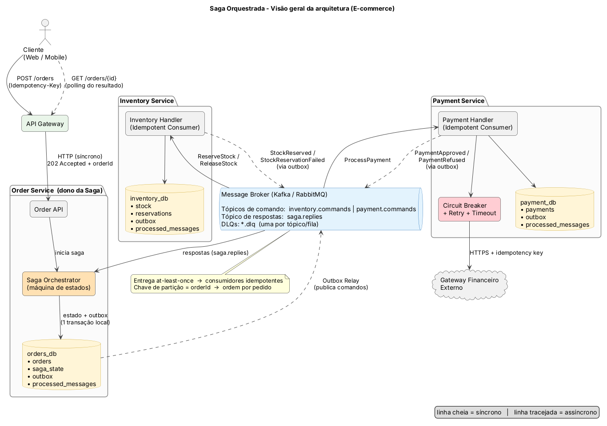
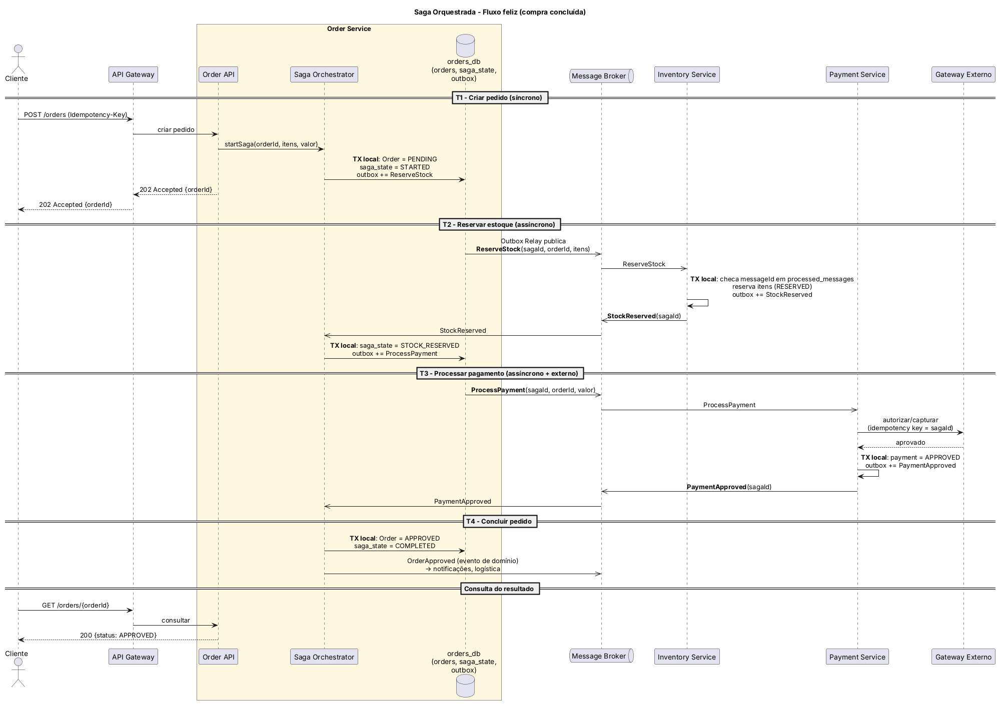
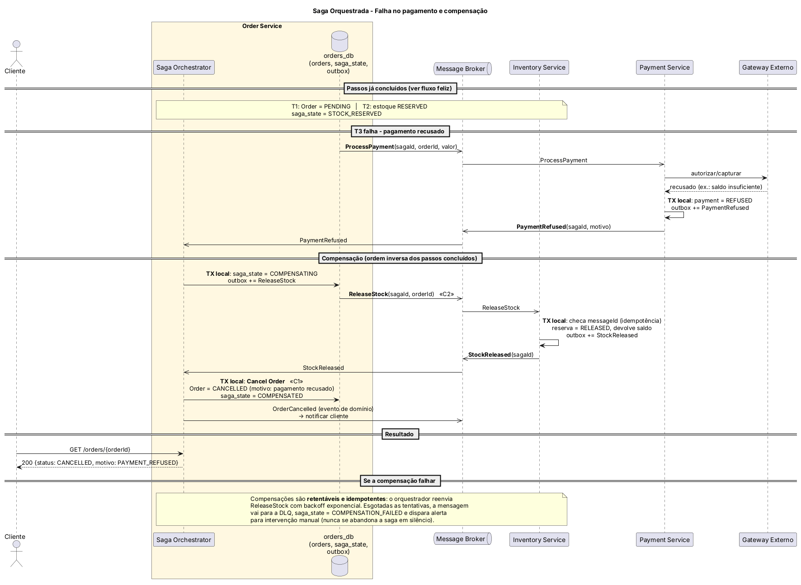

# Saga Orquestrada para o Fluxo de Compra de E-commerce

Blueprint de arquitetura para a migração de um monólito de e-commerce para microsserviços, usando o **padrão Saga (orquestração)** para garantir consistência eventual no fluxo crítico de compra (Pedido → Estoque → Pagamento).

> Este repositório contém apenas artefatos de arquitetura (diagramas e documentação). Não há código de aplicação.

## Sumário

1. [Contexto de negócio](#1-contexto-de-negócio)
2. [Decisão: Orquestração vs. Coreografia](#2-decisão-orquestração-vs-coreografia)
3. [Modelo da Saga](#3-modelo-da-saga)
4. [Diagramas](#4-diagramas)
5. [Idempotência e controle de estado](#5-idempotência-e-controle-de-estado)
6. [Estrutura do repositório](#6-estrutura-do-repositório)
7. [Referências](#7-referências)

---

## 1. Contexto de negócio

No monólito, a compra era uma única transação ACID: criar pedido, baixar estoque e registrar pagamento sucediam ou falhavam juntos. Ao migrar para microsserviços com **banco de dados por serviço**, essa transação deixa de existir, e o 2PC (two-phase commit) não é opção por acoplar a disponibilidade dos serviços e do broker e por não escalar bem.

Três domínios participam do fluxo, cada um com seu banco:

| Serviço | Responsabilidade | Banco |
|---|---|---|
| **Order Service** | Ciclo de vida do pedido (e dono da Saga) | `orders_db` |
| **Inventory Service** | Estoque e reservas temporárias | `inventory_db` |
| **Payment Service** | Cobrança via gateway financeiro externo | `payment_db` |

**Requisito de negócio central:** se o pagamento for recusado depois que o estoque foi reservado, a reserva deve ser desfeita e o pedido cancelado, automaticamente e sem intervenção humana.

## 2. Decisão: Orquestração vs. Coreografia

**Escolha: Saga baseada em Orquestração**, com o orquestrador hospedado no Order Service.

| Atributo | Coreografia | Orquestração (escolhida) |
|---|---|---|
| **Acoplamento** | Baixo no código, mas alto no *conhecimento implícito*: cada serviço precisa saber quais eventos de quais outros assinar. | Os participantes só conhecem seus comandos e respostas; o fluxo fica em um único lugar. |
| **Complexidade** | Cresce de forma não linear com o número de passos; o fluxo fica espalhado e difícil de enxergar e depurar. | Fluxo explícito (máquina de estados), fácil de ler, testar e evoluir. |
| **Risco de dependência cíclica** | Real (A escuta B, B escuta A). | Inexistente: participantes não se conhecem. |
| **Compensação** | Cada serviço precisa saber *quando* compensar a partir de eventos de falha de terceiros. | O orquestrador decide a ordem e emite os comandos de compensação. |
| **Observabilidade** | Rastrear exige correlacionar eventos de vários serviços. | O estado da saga está em uma tabela única e consultável. |
| **Escalabilidade** | Sem ponto central, mas o limite real é o broker. | O orquestrador é *stateless* por instância (estado no banco) e escala horizontalmente particionando por `orderId`. |
| **Ponto único de falha** | Nenhum componente dedicado. | O orquestrador poderia sê-lo; mitigado por réplicas + estado persistido + retomada de sagas pendentes. |

**Justificativa.** O fluxo tem três participantes com compensações explícitas, regras de negócio (pivô, timeouts, cancelamento) e requisito de auditoria sobre o estado de cada compra. Nesse cenário, o ganho de clareza, observabilidade e controle da compensação supera o custo de ter um coordenador. A coreografia seria mais atraente para fluxos curtos com 2 participantes e sem compensações complexas, o que não é o caso. O risco do orquestrador (ele não deve virar um "deus" com regra de negócio dos outros serviços) é tratado mantendo nele **apenas a sequência**: as regras (ex.: disponibilidade de estoque, autorização de pagamento) continuam nos serviços donos.

## 3. Modelo da Saga

Cada passo é uma **transação local** em um serviço; os que podem ser desfeitos têm uma **transação compensatória**.

| # | Transação | Serviço | Compensação | Tipo |
|---|---|---|---|---|
| T1 | Criar pedido (`PENDING`) | Order | **C1** Cancel Order | Compensável |
| T2 | Reservar estoque | Inventory | **C2** Release Stock | Compensável |
| T3 | Processar pagamento | Payment | n/a (reembolso é um processo de negócio separado) | **Pivô** |
| T4 | Aprovar pedido (`APPROVED`) | Order | n/a | Retentável (deve sempre concluir) |

Regras de ordenação: os passos que podem falhar por regra de negócio e são **compensáveis** vêm antes do pivô; depois do pivô só há passos **retentáveis**. A compensação ocorre na **ordem inversa** dos passos concluídos (C2 e depois C1).

**Mensagens.** Comandos: `ReserveStock`, `ReleaseStock`, `ProcessPayment`. Respostas: `StockReserved`, `StockReservationFailed`, `PaymentApproved`, `PaymentRefused`, `StockReleased`. Todas carregam `messageId` (UUID), `sagaId`, `orderId` e `timestamp`.

**Isolamento.** Como a saga não oferece o "I" do ACID, o pedido nasce como `PENDING` (*semantic lock*): consultas e outros fluxos o tratam como não confirmado, e só `APPROVED` libera expedição e notificação de sucesso.

## 4. Diagramas

Arquivos em [`/diagrams`](./diagrams) (PNG para leitura, `.puml` editáveis em PlantUML).

### 4.1 Visão geral da arquitetura



Mostra os três serviços com seus bancos, o orquestrador dentro do Order Service, o broker (comandos, respostas e DLQs) e o gateway financeiro externo protegido por Circuit Breaker. Todo serviço usa **Transactional Outbox** para atualizar o banco e publicar mensagem de forma atômica.

### 4.2 Fluxo de sucesso



O cliente recebe `202 Accepted` com o `orderId` logo após T1 (síncrono) e consulta o resultado por polling em `GET /orders/{id}` (alternativas: webhook ou WebSocket). T2 e T3 são assíncronos via broker; T4 conclui a saga.

### 4.3 Fluxo de falha e compensação



O Payment Service recusa o pagamento após a reserva de estoque. O orquestrador entra em `COMPENSATING`, emite `ReleaseStock` (C2), aguarda `StockReleased`, executa **Cancel Order** (C1) e finaliza em `COMPENSATED`. Se a compensação falhar, ela é reenviada com backoff; esgotadas as tentativas, vai para a DLQ e a saga fica `COMPENSATION_FAILED` com alerta.

## 5. Idempotência e controle de estado

### 5.1 Idempotent Consumer

O broker entrega *at-least-once*, então **duplicatas e reentregas são esperadas**. Cada serviço que consome mensagens mantém uma tabela `processed_messages`:

| Passo | Ação |
|---|---|
| 1 | Na **mesma transação local** do efeito de negócio, inserir `messageId` em `processed_messages` (chave única). |
| 2 | Se o insert violar a unicidade, a mensagem é duplicata: **não reexecutar**, apenas reconfirmar (ack) e, se for o caso, reenviar a resposta anterior. |
| 3 | Operações naturalmente idempotentes (`ReleaseStock` sobre reserva já `RELEASED`) viram no-op. |

No gateway de pagamento, `sagaId` é usado como **idempotency key**, de modo que um retry após timeout não cobra duas vezes. Na API pública, o cabeçalho `Idempotency-Key` evita pedidos duplicados por duplo clique ou retry do cliente.

### 5.2 Tabela de estado da Saga (`saga_state`)

| Coluna | Descrição |
|---|---|
| `saga_id` (PK), `order_id` | Identificadores |
| `status` | `STARTED`, `STOCK_RESERVED`, `PAYMENT_PENDING`, `COMPLETED`, `COMPENSATING`, `COMPENSATED`, `COMPENSATION_FAILED` |
| `current_step` | Passo em andamento (T1–T4 / C1–C2) |
| `retry_count` | Tentativas do passo atual |
| `last_message_id` | Última mensagem processada (descarta respostas fora de ordem/duplicadas) |
| `deadline_at` | Prazo do passo atual (base dos timeouts) |
| `version` | Controle de concorrência otimista |
| `updated_at`, `failure_reason` | Auditoria |

### 5.3 Timeouts de rede

Um *saga reaper* (job periódico) varre sagas não terminais com `deadline_at` vencido:

| Situação | Tratamento |
|---|---|
| Sem resposta em T2 (estoque) | Reenviar `ReserveStock` (idempotente) com backoff; após N tentativas, `COMPENSATING` (C1). |
| Sem resposta em T3 (pagamento) | **Não assumir recusa.** Consultar o status do pagamento (query por idempotency key) e só então decidir: aprovado → T4; recusado/inexistente → compensar. |
| Sem resposta em compensação | Reenviar (compensações são idempotentes e retentáveis); após esgotar, DLQ + `COMPENSATION_FAILED` + alerta. |
| Resposta tardia após timeout | Descartada pela checagem de `status`/`version`/`last_message_id`; o estado da saga é a fonte da verdade. |

Detalhes de Retry, Circuit Breaker, DLQ e riscos em [`docs/decisoes-arquiteturais.md`](./docs/decisoes-arquiteturais.md).

## 6. Estrutura do repositório

```
.
├── README.md
├── diagrams/
│   ├── saga-architecture-overview.png / .puml
│   ├── sequence-success-flow.png / .puml
│   └── sequence-compensation-flow.png / .puml
└── docs/
    └── decisoes-arquiteturais.md
```

Para regerar os PNG a partir dos fontes: `java -jar plantuml.jar -tpng diagrams/*.puml`.

## 7. Referências

- Chris Richardson, [Pattern: Saga](https://microservices.io/patterns/data/saga.html), microservices.io
- Chris Richardson, [Pattern: Transactional Outbox](https://microservices.io/patterns/data/transactional-outbox.html)
- Chris Richardson, *Microservices Patterns* (Manning), cap. 4
